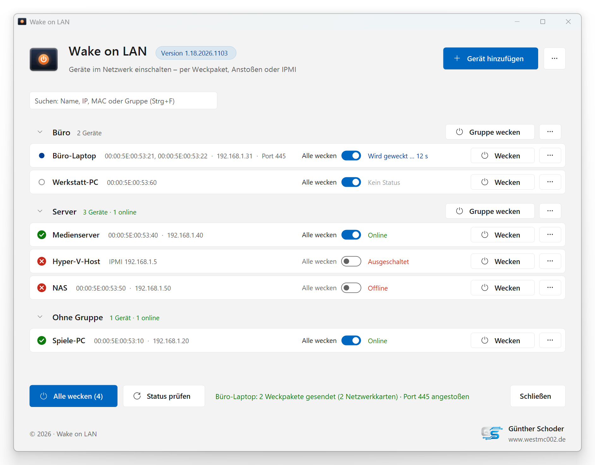
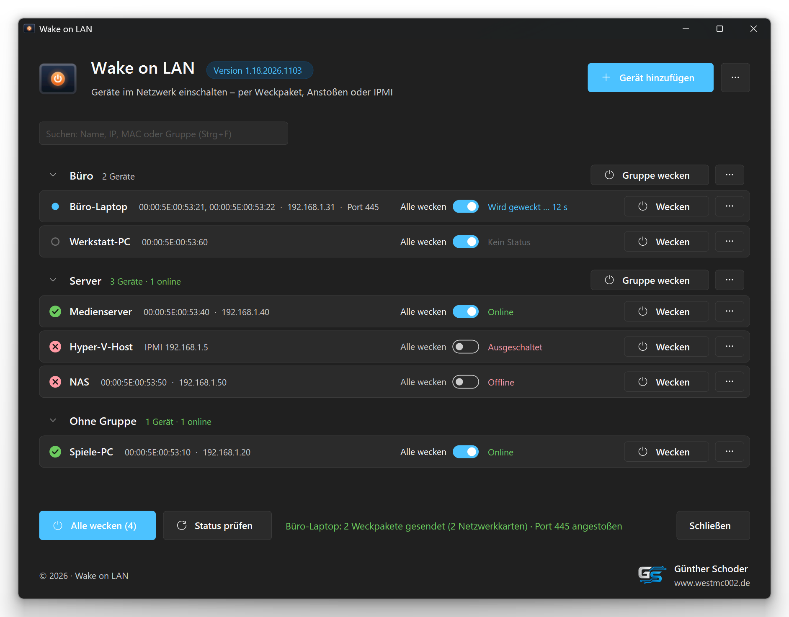
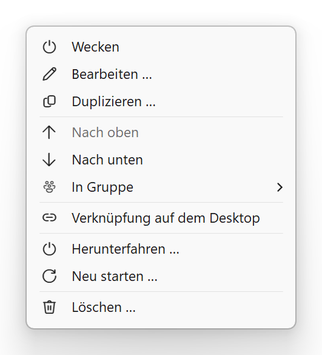
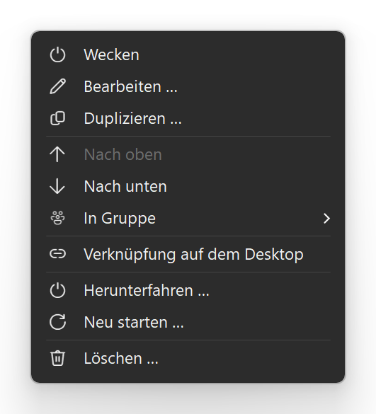
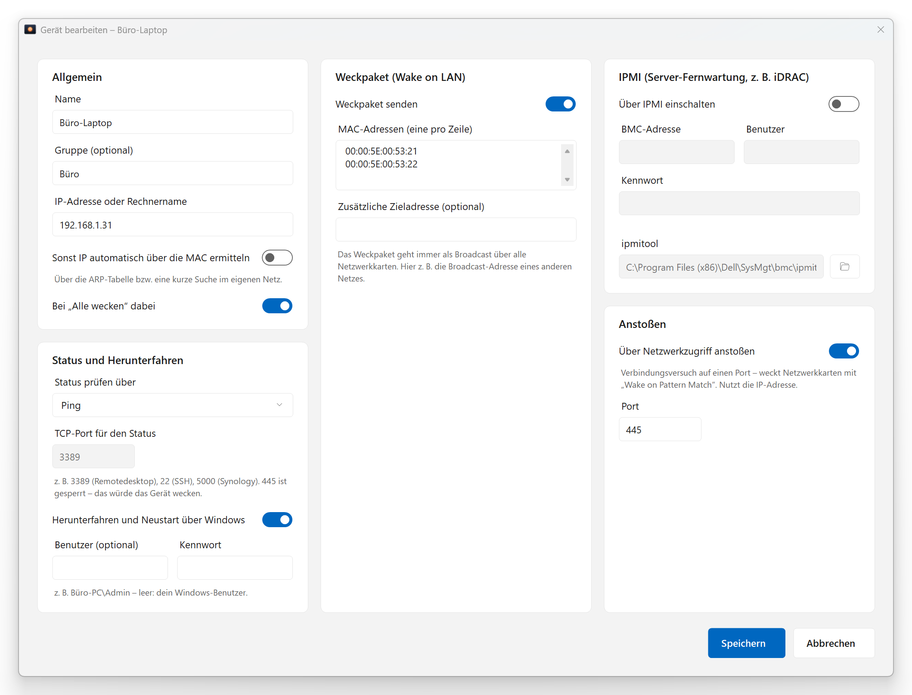
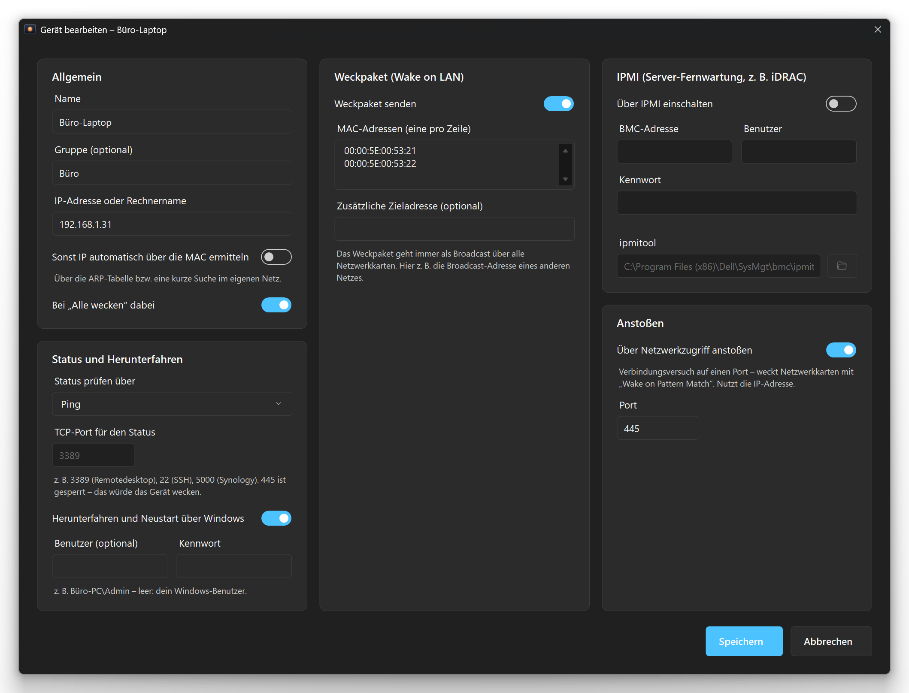
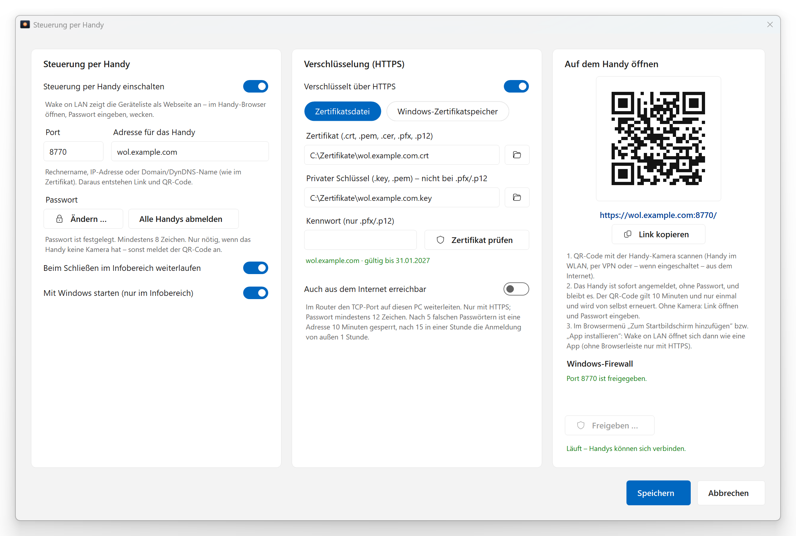
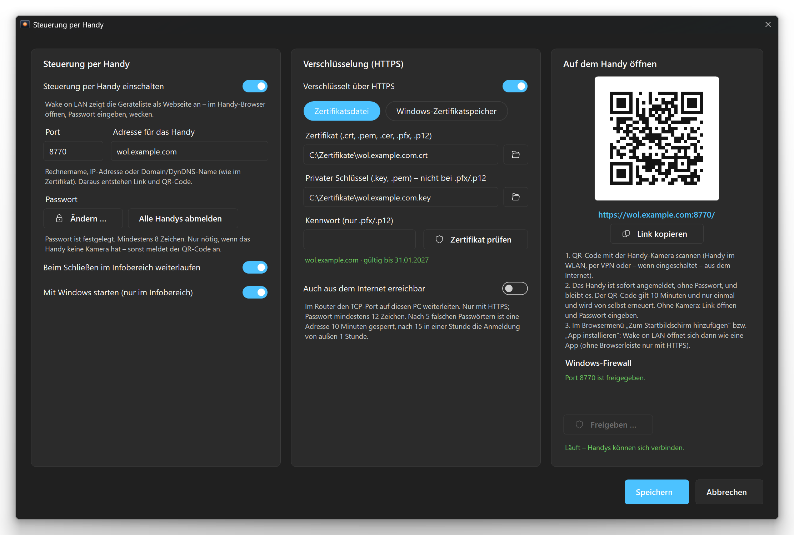
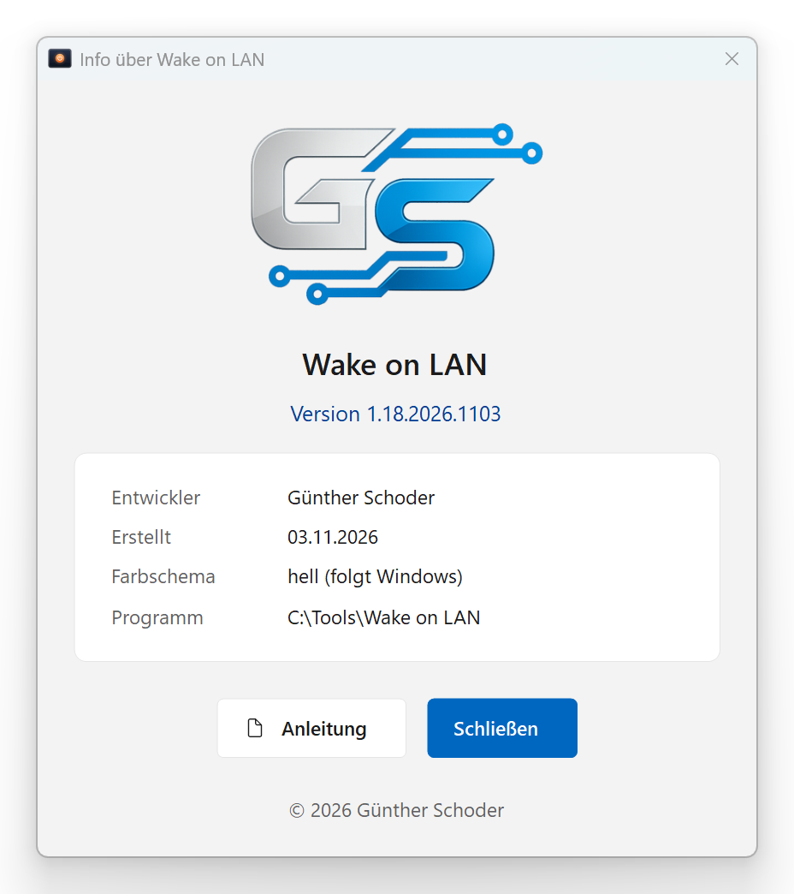
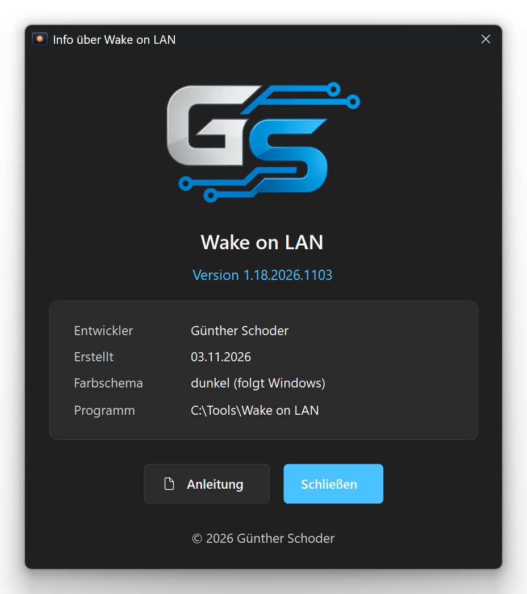

# Wake on LAN

Schaltet Geräte im Netzwerk ein – per Weckpaket (Magic Packet), per Anstoß über einen Port oder bei Servern über IPMI (z. B. Dell iDRAC).
Im Design von Windows 11 (hell und dunkel, mit der Windows-Akzentfarbe), mit Gruppen, Statusanzeige, Zeitplänen, Sprungliste in der Taskleiste und Steuerung per Handy.

| Hell | Dunkel |
|---|---|
|  |  |

Weitere Screenshots

| Hell | Dunkel |
|---|---|
|  |  |
|  |  |
|  |  |
|  |  |

Die Screenshots zeigen erfundene Beispieldaten. Sie entstehen automatisch beim Erstellen (`"Wake on LAN.exe" --screenshots`).

## Funktionen

- **Drei Arten zu wecken**, je Gerät kombinierbar:
  - Weckpaket an eine oder mehrere MAC-Adressen, als Broadcast über alle aktiven Netzwerkkarten (optional zusätzliche Zieladresse)
  - Anstoßen: Verbindungsversuch auf einen Port (Standard 445) für Netzwerkkarten mit „Wake on Pattern Match“
  - IPMI über `ipmitool`: erst Zustand abfragen, nur bei „aus“ einschalten; Kennwort verschlüsselt gespeichert
- **Status** – grün/rot mit „zuletzt online vor …“, je Gerät über Ping, TCP-Port, beides, IPMI oder aus; Ports, die Geräte wecken würden (445, 139, 137), sind dafür gesperrt
- **IP automatisch über die MAC** – per ARP-Tabelle bzw. kurzer ARP-Suche im eigenen Netz, falls sich die IP per DHCP ändert
- **Gruppen** – ganze Gruppe wecken oder herunterfahren, zuklappen, umbenennen, sortieren; Geräte und Gruppen per Drag & Drop anordnen
- **„Alle wecken“** – Schalter direkt in jeder Gerätezeile, der Knopf zeigt die Anzahl
- **Herunterfahren und Neustart** – Windows-PCs (optional mit hinterlegtem Benutzer und Kennwort) bzw. Server sanft über IPMI
- **Steuerung per Handy** – die Geräteliste als Webseite für Handy und Tablet (keine App nötig): Anmeldung per QR-Code ohne Passwort (Einmal-Code) oder mit Passwort, als App auf dem Startbildschirm; optional verschlüsselt mit eigenem Zertifikat (Datei oder Windows-Zertifikatspeicher, z. B. Let's Encrypt, Erneuerung wird automatisch übernommen) und optional per Portfreigabe aus dem Internet erreichbar (mit Sperre nach falschen Passwörtern). Läuft dazu im Infobereich weiter und startet auf Wunsch mit Windows
- **Zeitpläne** – z. B. „Server Mo–Fr um 07:00 wecken“, über die Windows-Aufgabenplanung
- **Sprungliste und Kommandozeile** – Alle wecken, Gruppen und Geräte direkt aus der Taskleiste; `"Wake on LAN.exe" Büro-PC`, `/alle`, `"/gruppe:Server"`; Desktop-Verknüpfungen auf Knopfdruck
- **Benachrichtigungen** – Windows-Meldung, sobald das geweckte Gerät online ist
- **Suche, Verlauf, Export/Import** – Suche nach Name, IP, MAC oder Gruppe; Verlauf aller Aktionen; Geräteliste als XML sichern und übertragen
- **Übernahme alter Skripte** – liest Batch-Skripte der Form `Wake on LAN (<Gerät>).bat` ein

## Installation

1. Unter [Releases](../../releases) die neueste `Wake-on-LAN-<Version>.zip` herunterladen.
2. `Wake on LAN.exe` (und `Liesmich.txt`) in einen eigenen Ordner mit Schreibrechten entpacken, z. B. `C:\Tools\Wake on LAN`.
3. Starten und Geräte anlegen (oder über „…“ › „Aus alten Skripten übernehmen“ einlesen).
4. Zum schnellen Wecken das Programm an die Taskleiste anheften – die Sprungliste (Rechtsklick) zeigt dann Gruppen und Geräte.

Voraussetzungen: Windows 10 oder 11 (.NET Framework 4.5 oder neuer ist dort vorhanden). Für IPMI wird `ipmitool` gebraucht (z. B. aus den Dell OpenManage BMC Utilities).
Die Geräteliste liegt unter `%LOCALAPPDATA%\Wake on LAN\Geräte.xml`, der Programmordner bleibt unverändert.

## Selbst kompilieren

`Erstellen.bat` im Hauptordner ausführen. Sie nutzt den C#-Compiler aus dem .NET Framework 4, der bei Windows dabei ist – ein Visual Studio ist nicht nötig.
Die Version (Haupt.Neben.Jahr.MonatTag) wird dabei automatisch hochgezählt, die bisherige EXE wird unter `Backup` gesichert; auf Nachfrage werden die Screenshots in `Screenshots` neu erstellt.

## Projektaufbau

| Pfad | Inhalt |
|---|---|
| `Quellcode\` | C#-Quelldateien (WinForms, .NET Framework 4) und `app.manifest` |
| `Resources\` | Icon, GS-Logo, Beispieldaten `Demo.xml` für die Screenshots und die Handy-Webseite `Web\` (werden in die EXE eingebettet) |
| `Screenshots\` | Bilder für diese Seite, hell und dunkel (erzeugt die `Erstellen.bat`) |
| `Erstellen.bat` | Build-Skript |
| `Liesmich.txt` | Ausführliche Beschreibung und Versionsgeschichte |

## Lizenz

GNU General Public License v3.0 oder später – siehe [LICENSE](LICENSE).

Ausnahme: Das GS-Logo (`Resources\GS-Logo.png`) steht nicht unter dieser Lizenz. Alle Rechte vorbehalten; es darf nur unverändert zusammen mit dem Programm weitergegeben werden.

Dieses Projekt ist nicht mit Microsoft oder Dell verbunden. Genannte Marken gehören ihren jeweiligen Inhabern.

## Autor

Günther Schoder · [www.westmc002.de](https://www.westmc002.de)
